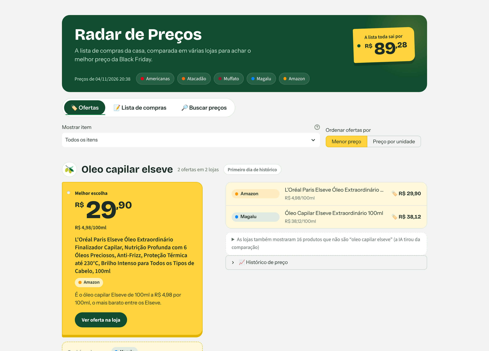
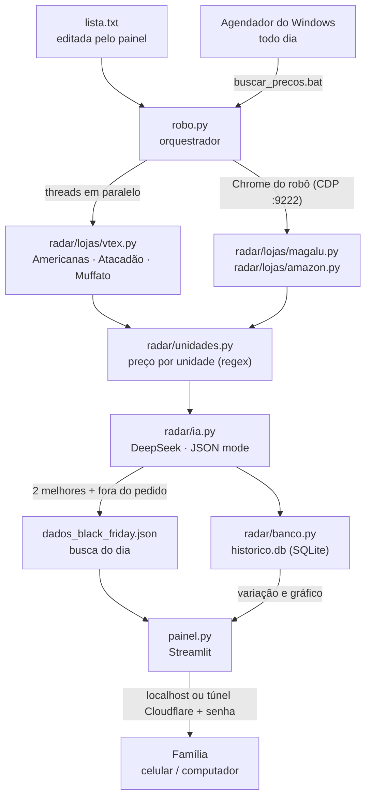
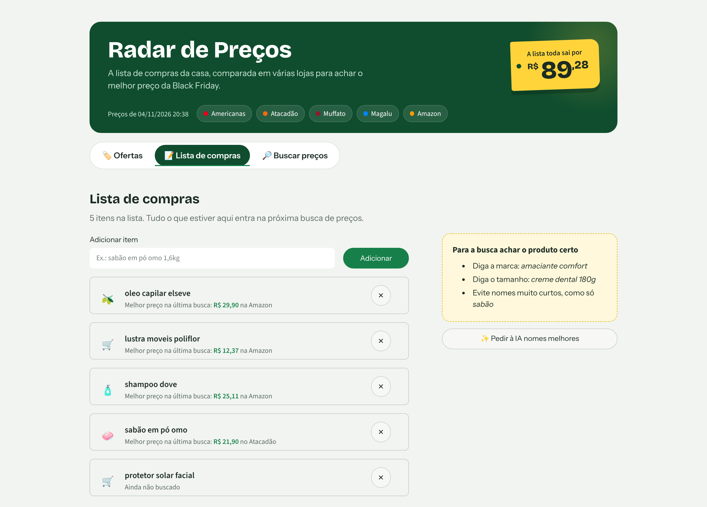
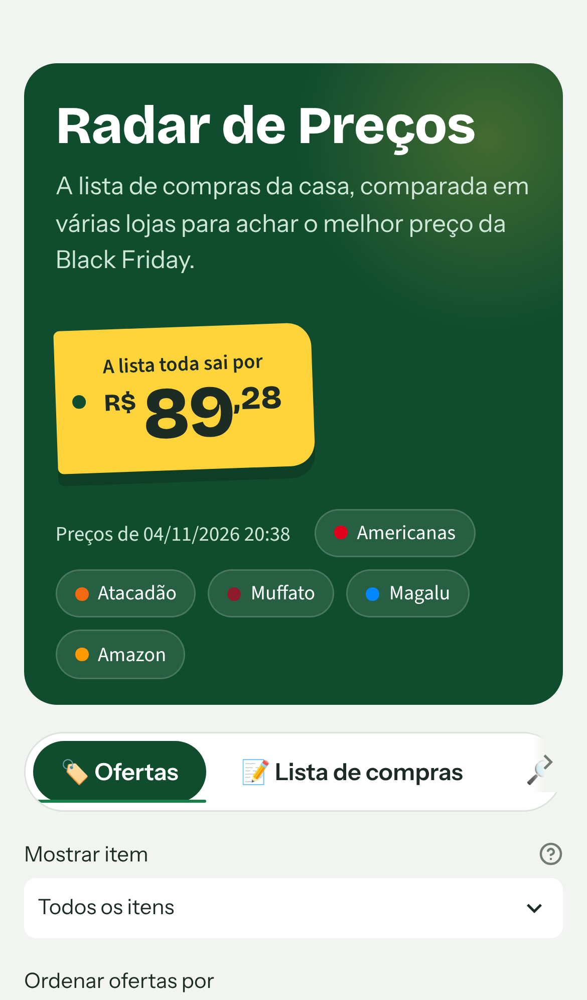

# 🏷️ Radar de Preços

Sistema que **compara os preços da lista de compras da casa em cinco lojas online**, usa IA para escolher o melhor custo-benefício de cada item e guarda o histórico diário para mostrar se o desconto da Black Friday é real.

Projeto pessoal de **Emily Cristofoleti**, feito para a lista de compras da família.

<p align="center">
  
</p>

🌐 **Site do projeto:** [new-emi.github.io/Radar-de-Precos](https://new-emi.github.io/Radar-de-Precos/) · 📘 [Documentação técnica](https://new-emi.github.io/Radar-de-Precos/documentacao.html)

---

## 1. Visão geral

- **O que faz:** lê a lista de compras, procura cada item em Americanas, Atacadão, Muffato, Magalu e Amazon, calcula o preço por unidade (R$/L, R$/100 g, R$/10 m, R$/un) e pede a uma IA as duas melhores compras de cada item.
- **Para quem:** quem faz a compra do mês de produtos de casa, higiene e limpeza e quer saber, sem abrir cinco sites, onde cada item sai mais barato.
- **O que entrega:** um painel web (Streamlit) com a melhor escolha de cada item numa "etiqueta de gôndola", todas as ofertas comparáveis, o total da lista, o histórico de preço por dia e uma busca automática diária.

## 2. Contexto, problema e solução

**Problema.** Para comparar uma lista de 37 itens em cinco lojas é preciso fazer 185 buscas, e os preços não se comparam direto: um amaciante de 500 ml e um de 5 L, um papel higiênico de 12 rolos de 20 m e outro de 24 rolos de 30 m. A busca das lojas também devolve muita coisa que não é o produto pedido (absorvente na busca de protetor solar).

**Solução.** Um ciclo em 5 etapas:

1. **Lista:** a família edita a lista no painel, pelo celular ou pelo computador.
2. **Coleta:** o robô busca cada item nas lojas. As lojas VTEX são consultadas pela API JSON, em paralelo. Magalu e Amazon passam por um Chrome real controlado pelo robô.
3. **Preço por unidade:** o título de cada produto é lido com expressões regulares ("1,5L", "3x120fls", "kit 3 un") e todos os produtos do item ficam na mesma régua.
4. **Curadoria por IA:** o DeepSeek recebe as ofertas numeradas, tira o que não é o produto pedido e escolhe as duas melhores. Nome, preço e link vêm sempre do produto real, nunca do texto da IA.
5. **Histórico e painel:** cada busca é gravada em SQLite. O painel mostra a variação ("↓ 8% abaixo dos últimos dias") e o gráfico do preço.

## 3. Diagrama do pipeline



## 4. Estrutura do repositório

```text
Radar-de-Precos/
├── robo.py                  # A BUSCA: orquestra lojas, IA e histórico (python robo.py)
├── painel.py                # O SITE: interface Streamlit (streamlit run painel.py)
├── radar/                   # O pacote com as peças do sistema
│   ├── config.py            # Caminhos e leitura do .env
│   ├── ia.py                # Prompt e chamada ao DeepSeek (com novas tentativas)
│   ├── unidades.py          # Quantidade no título -> R$/L, R$/100g, R$/10m, R$/un
│   ├── banco.py             # Histórico em SQLite: gravação e consultas
│   ├── analise.py           # "O desconto da Black Friday foi real?" (regras do pré-registro)
│   ├── navegador.py         # Abre/detecta o Chrome do robô (porta 9222)
│   ├── texto.py             # Limpeza de títulos e preços
│   ├── estilo.css           # Visual do painel
│   └── lojas/
│       ├── __init__.py      # Cadastro das lojas (uma linha por loja VTEX)
│       ├── vtex.py          # Americanas, Atacadão, Muffato (API JSON)
│       ├── magalu.py        # Magalu (via Chrome)
│       ├── amazon.py        # Amazon (via Chrome)
│       ├── mercado_livre.py # ML pelo site (desligado: captcha)
│       └── ml_api.py        # ML pela API oficial (bloqueada pelo ML; ver seção 7)
├── scripts/
│   ├── avaliar_ia.py        # Testa o prompt da IA nos dados já coletados (segundos)
│   ├── testar_lojas_novas.py# Descobre se uma loja candidata usa VTEX
│   ├── analise_black_friday.py # Gera o relatório da Black Friday (docs/black-friday.html)
│   └── windows/             # Atalhos: abrir painel, link para a família, busca agendada
├── tests/                   # 54 testes automáticos (pytest), sem internet
├── exemplos/                # Dados de exemplo: o painel abre mesmo sem rodar o robô
├── docs/                    # Site (GitHub Pages), prints, histórico de decisões e metodologia da análise
├── lista_estudo.txt         # Lista FIXA do estudo da Black Friday (casa × típicos de BF)
├── requirements.txt         # Dependências com versões fixadas
├── requirements-dev.txt     # + pytest e pyflakes
├── env.exemplo              # Modelo do .env (copiar para .env)
└── LICENSE                  # MIT
```

O `.env`, a `lista.txt`, o `dados_black_friday.json`, o `historico.db` e os registros **não são versionados** (ver `.gitignore`): são segredos ou dados pessoais gerados em tempo de execução.

## 5. Stack e pré-requisitos

| Item | Versão / observação |
|---|---|
| Python | 3.11 |
| `streamlit` | 1.66.1: painel web |
| `playwright` | 1.64.1: controla o Chrome do robô via CDP |
| `curl_cffi` | 0.17.0: requisições com "assinatura" TLS de Chrome (API VTEX) |
| `openai` | 3.43.0: cliente compatível com a API do DeepSeek |
| `beautifulsoup4` + `lxml` | 4.15.0 / 6.1.3: leitura de HTML |
| Gráfico do histórico | SVG desenhado no próprio `painel.py` (sem pandas; ver seção 7) |
| `sqlite3` | stdlib: histórico de preços |
| DeepSeek | modelo `deepseek-chat`, `response_format=json_object` |
| Google Chrome | aberto com `--remote-debugging-port=9222` (o robô abre sozinho) |
| `cloudflared` | opcional: link público temporário para a família acessar de fora |

## 6. Setup e execução

### 6.1 Instalar

```powershell
git clone https://github.com/new-emi/Radar-de-Precos.git
cd Radar-de-Precos
python -m venv .venv
.\.venv\Scripts\Activate.ps1
python -m pip install -r requirements.txt
```

### 6.2 Configurar

```powershell
copy env.exemplo .env      # e preencha a DEEPSEEK_API_KEY
```

Sem nenhuma busca feita, o painel já abre com os **dados de exemplo** de `exemplos/`.

### 6.3 Rodar

```powershell
streamlit run painel.py    # o painel (a busca pode ser disparada por ele)
python robo.py             # ou a busca direto pelo terminal
```

### 6.4 Busca automática diária (Windows)

```powershell
powershell -ExecutionPolicy Bypass -File scripts\windows\agendar_busca.ps1 -Hora 11:00
Start-ScheduledTask -TaskName "Radar de Precos"   # testar agora
```

O registro de cada busca fica em `busca_automatica.log`. Se o PC estiver desligado no horário, a tarefa roda assim que ele ligar.

### 6.5 Acesso de fora de casa (temporário)

`scripts\windows\abrir_para_mae.bat` abre o painel e um túnel do Cloudflare (`https://….trycloudflare.com`). Com `PAINEL_SENHA` no `.env`, quem entra pelo link precisa da senha. No próprio PC, o acesso continua direto.

### 6.6 Testes

```powershell
python -m pip install -r requirements-dev.txt
python -m pytest                       # 54 testes, sem internet
python scripts\avaliar_ia.py "protetor solar facial"   # testa o prompt nos dados já coletados
```

## 7. Decisões técnicas justificadas

Cada decisão abaixo veio de um problema real, observado e medido durante o desenvolvimento.

- **Google Shopping descartado.** Era o agregador ideal, mas bloqueou o Playwright com captcha de "tráfego incomum", mesmo com `playwright-stealth` e perfil persistente. O projeto passou a consultar as lojas direto.
- **API VTEX em vez de raspar HTML.** Americanas, Atacadão e Muffato usam a plataforma VTEX, que expõe `/api/io/_v/api/intelligent-search/product_search`. O endpoint clássico `/api/catalog_system/pub/products/search` devolvia 400 com termos genéricos. A resposta é JSON, então não quebra quando o site muda o layout, e traz estoque: produtos com `AvailableQuantity = 0` são descartados.
- **Teste de lojas antes de cadastrar.** O `scripts/testar_lojas_novas.py` consultou 14 lojas candidatas (04/11/2026). Muffato respondeu 9/9 com preço e entrou. Carrefour e Drogasil deram 503 (firewall), Condor, Panvel e Época 404 (não são VTEX), Beleza na Web 403. Drogaria São Paulo e Pacheco funcionam, mas são o mesmo grupo, com o mesmo catálogo e o mesmo preço (R$ 9,39 no mesmo creme dental), então só uma entraria. Cada loja VTEX nova é **uma linha** em `radar/lojas/__init__.py`.
- **Chrome real (CDP) para Magalu e Amazon.** Os dois bloqueiam `requests`, `curl_cffi` e Playwright headless (403/503). O robô se conecta a um Chrome normal aberto com `--remote-debugging-port=9222` e navega como uma pessoa. As esperas fixas foram trocadas por `wait_for_selector` (espera o primeiro produto aparecer, no máximo 15 s).
- **Mercado Livre desligado, e o captcha não é burlado.** O site devolve a página "Por segurança, complete esta etapa", e no Chrome real pede captcha (`/captcha/wall/logged`) **a cada busca**. A API oficial foi testada com login OAuth válido: `/sites/MLB/search` **e** `/products/search` responderam `403 PA_UNAUTHORIZED_RESULT_FROM_POLICIES` (04/11/2026), porque o ML só libera busca para parceiros. A decisão foi não resolver captcha automaticamente, já que isso seria contornar a proteção do site. O ML fica desligado (`ML_ATIVO=0`). Quando ligado, o robô busca o ML primeiro, para a verificação aparecer no primeiro minuto, e **pausa até uma pessoa resolver**.
- **Paralelismo com threads.** As buscas VTEX são só pedidos HTTP: todas são disparadas de uma vez (`ThreadPoolExecutor`) enquanto o Chrome, que faz uma coisa por vez, cuida de Magalu e Amazon. A análise da IA também roda em paralelo. Uma busca agendada real de **37 itens × 5 lojas** levou cerca de **9 minutos** e trouxe **757 ofertas**.
- **Preço por unidade calculado no código, não pela IA.** Antes, só a IA fazia a conta, e às vezes errava. `radar/unidades.py` lê a quantidade com regex e cobre cerca de **90% das ofertas reais**. Cada erro encontrado virou um teste:
  - "Veja 500ml **com 10% de desconto**" era lido como 10 unidades. Corrigido com o lookahead `(?!\s*%)`.
  - Em saco de lixo, "50L" é capacidade e não conteúdo, e gerava "R$ 0,01/L". Itens de capacidade passaram a comparar por unidade.
  - "3 rolos 360 folhas" é o total, mas "3 pacotes 120 fls" é por pacote e precisa multiplicar.
  - Papel higiênico passou a comparar por **R$/10 m**, a comparação mais justa entre pacotes de 12 e 24 rolos.
- **Uma régua por item.** Protetor solar aparecia como "R$ 539,80/L", certo mas ilegível, e a IA chegou a comparar R$/100g com R$/L no mesmo item. Agora o item inteiro usa a mesma unidade: se a **mediana** dos volumes fica abaixo de 1 L, a régua é R$/100ml. A mediana não é distorcida por um galão de 5 L no meio de frascos de 50 ml.
- **A IA escolhe por número (id), não por nome.** No começo a IA devolvia o nome do produto e o painel procurava o link comparando os 15 primeiros caracteres, o que podia ligar a recomendação ao produto errado. Agora as ofertas vão numeradas, a IA responde só os ids em JSON (`response_format=json_object`), e nome, preço e link são copiados do produto real.
- **Prompt com regras e exemplos.** A primeira versão ("descarte o que não é o produto pedido") escondia as versões **Men** e **Clinical** do desodorante Rexona, porque a IA *supôs* que era para mulher. O prompt (`radar/ia.py`) passou a listar o que **conta** como fora do pedido (outro tipo de produto, outra marca ou outro formato quando pedidos) e o que **não conta** (outra versão, fragrância, tamanho ou kit), com exemplos reais e a regra "não suponha quem vai usar". Reavaliado com `scripts/avaliar_ia.py` nos mesmos dados: Rexona passou de 9 ofertas escondidas para **0**, e no protetor solar facial continuaram fora o absorvente, a sandália e os protetores de corpo.
- **Novas tentativas com espera (retry + backoff).** Numa busca de 37 itens, a IA devolveu 4 respostas sem recomendação válida, espalhadas em 3 itens. O robô tenta até 3 vezes, esperando 2 s, 4 s e 6 s, e todos os itens saíram com recomendação.
- **Títulos da Magalu.** A Magalu não expõe o título num campo fixo. O fallback pela URL perde acentos e vírgulas: "Omo 1,4kg" virava "**14kg**" por R$ 19,20, e a IA escolheu esse produto. Agora o título vem do texto do card, e o da URL é marcado como `titulo_aproximado`. Nesse caso nem o painel nem a IA calculam preço por unidade.
- **Histórico compara a melhor escolha, não o mais barato.** O selo do barbeador elétrico chegou a mostrar "↑ **1114%**": comparava o elétrico de R$ 129 escolhido pela IA com um aparelho manual de R$ 9,90. O histórico passou a seguir o preço da **escolha da IA** de cada dia.
- **Histórico compara por unidade.** Ao conferir os selos com dados reais de dois dias, 10 dos 37 itens mostravam variações acima de 70%. A conta estava certa, mas comparava embalagens diferentes: no absorvente, a melhor escolha foi o pacote de 16 em 04/11 e o de 48 em 05/11, e o selo dizia "↑ 190%" quando, por unidade, o preço caiu 3%. Agora a comparação é pelo preço por unidade (R$/L, R$/100 g, R$/10 m), ou pelo preço quando é o mesmo produto, e "já custou R$ X" só fala do mesmo produto. O cálculo usa o valor sem arredondar: em centavos, R$ 0,406/un e R$ 0,393/un viram 0,41 e 0,39, e a diferença de 3,2% viraria 4,9%.
- **Chave dos anúncios patrocinados da Amazon.** O link dos patrocinados é `/sspa/click?...&url=%2FProduto%2Fdp%2FB0CVXT2K1S...`, com o produto codificado dentro do link. Como a chave cortava tudo depois do `?`, 213 das 531 ofertas da Amazon viravam um único "produto". O `unquote()` decodifica o link antes de procurar o ASIN.
- **Gráfico sem pandas.** O Controle Inteligente de Aplicativos do Windows 11, ao sair do modo de avaliação e ligar de vez, passou a bloquear um arquivo compilado do pandas (`ImportError: DLL load failed ... Uma política de Controle de Aplicativo bloqueou este arquivo`), e o painel parou de abrir. O pandas só servia para o gráfico, então o gráfico passou a ser um SVG gerado em Python puro, o que dispensou desligar uma proteção do sistema que não pode ser religada. O painel foi testado com `pandas` e `pyarrow` proibidos de carregar. No SVG, cada `$` vira `&#36;`, porque no Markdown do Streamlit um texto entre dois `$` é interpretado como fórmula LaTeX.
- **SQLite como banco.** Uma linha por produto em cada busca, num único arquivo e com a stdlib. Duas tabelas (`buscas` e `precos`) ligadas por chave estrangeira, gravação em transação (ou grava a busca inteira, ou nada) e consultas parametrizadas (`?`).
- **Lista salva por callback.** A mãe adicionava um item pelo celular, ia direto para a busca, e o item "sumia". Pelo horário dos arquivos, ele nunca tinha sido salvo: o campo era um formulário que só salva no botão. Agora o campo usa `on_change`, que salva ao apertar Enter ou tocar fora, mostra um aviso, ignora repetidos e tem "Desfazer" ao remover.
- **Senha só para quem vem da internet.** O painel lê o cabeçalho `Host` do pedido. `localhost` e a rede de casa entram direto, e o endereço do túnel pede `PAINEL_SENHA`. A comparação usa `hmac.compare_digest`, que não revela pelo tempo de resposta quantas letras acertaram. O `.env` é relido a cada acesso, então tirar ou colocar a senha vale na hora.

## 8. Evidências de funcionamento

| Métrica | Valor |
|---|---|
| Busca agendada (04/11/2026, 16:57) | 37 itens, 5 lojas, **757 ofertas**, ~9 min |
| Ofertas por loja nessa busca | Americanas 101 · Atacadão 124 · Muffato 162 · Magalu 185 · Amazon 185 |
| Itens com recomendação da IA | 37 de 37 (3 recuperados por nova tentativa) |
| Testes automáticos | 54 passando (`python -m pytest`) |
| Compatibilidade | Python 3.11 (ambiente de produção) |

<p align="center">
  
  
</p>

## 9. Black Friday 2026: o desconto foi real?

O histórico diário existe para responder a uma pergunta: **os preços da Black Friday foram realmente menores, ou as lojas subiram o preço antes para anunciar um "desconto"?**

- **Grupo de controle:** uma lista fixa do estudo ([`lista_estudo.txt`](lista_estudo.txt)), congelada em 05/11, com 10 itens de casa e 10 itens típicos de Black Friday, escolhidos a partir dos levantamentos dos Procons (fritadeira de 4 L, sanduicheira, smart TV 43"...). Hipótese: a maquiagem de desconto é mais comum no segundo grupo.
- **Regras definidas antes dos dados** (pré-registro, 05/11/2026): [`docs/METODOLOGIA_BLACK_FRIDAY.md`](docs/METODOLOGIA_BLACK_FRIDAY.md). Janelas Base (05–15/11), Pré-Black Friday (16–26/11) e Black Friday (27–30/11); limiar de 5%; classes *desconto real*, *maquiagem de desconto*, *sem mudança* e *ficou mais caro*.
- **Cada produto é acompanhado pela mesma chave ao longo dos dias.** Na Amazon é o código ASIN, porque o link muda a cada busca: 59 de 183 produtos tinham links diferentes para o mesmo item.
- **Análise validada antes de existirem dados:** num banco simulado com padrões conhecidos (35% desconto real, 25% maquiagem...), o método recuperou as proporções esperadas. Há também 10 testes com casos feitos à mão para cada classe.
- **Resultado:** publicado depois de 30/11 em `docs/black-friday.html`, gerado por `python scripts\analise_black_friday.py`.

## 10. Segurança

- Chaves (DeepSeek, Mercado Livre) só no `.env`, fora do Git. O `env.exemplo` documenta as variáveis sem valores.
- O token OAuth do ML (`ml_token.json`) é renovado sozinho e também fica fora do Git.
- O painel pede senha para acesso externo, e o link do túnel é temporário (muda a cada abertura).
- A IA nunca "inventa" preço ou link: ela só aponta ids de produtos que o robô coletou.
- O robô não contorna captcha: quando uma loja pede verificação, ele espera uma pessoa resolver.

## 11. Roadmap

- [x] Preço por unidade, histórico em SQLite, busca diária, paralelismo
- [x] Prompt da IA com regras e exemplos + script de avaliação
- [ ] **Publicar o resultado da análise da Black Friday** (após 30/11)
- [ ] **Online de verdade:** banco no Supabase, painel no Streamlit Community Cloud, lojas VTEX + IA no GitHub Actions e Magalu/Amazon no PC enviando para o mesmo banco
- [ ] Alertas (WhatsApp/Telegram) quando um item cair mais de X%
- [ ] Títulos da Magalu pelo JSON interno da página (`__NEXT_DATA__`), em vez do texto do card
- [ ] Carrefour e Drogasil pelo navegador (a API bloqueia)
- [ ] Palavras-chave inteligentes: se um termo trouxer 0 resultados, a IA sugere uma variação

O histórico completo das lojas testadas e das decisões está em [`docs/BACKLOG.md`](docs/BACKLOG.md).

---

### Autora

**Emily Cristofoleti** — estudante de Inteligência Artificial · PUCPR
